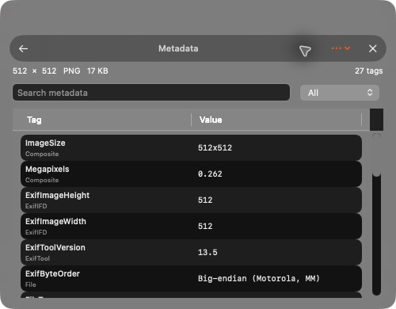

# Dice

A small native Mac app to convert, resize and compress images, and to inspect and remove metadata. Everything stays on your Mac.

macOS 14+ · Apple silicon

## Install

1. [Download Dice](https://github.com/lumen-xx/dice/releases/latest), unzip and move **Dice.app** to **Applications**.
2. Open it. If macOS blocks it, go to **System Settings → Privacy & Security → Open Anyway**.

Dice is not notarized yet.

## Use

Drop images, PDFs, SVGs or folders on the window, paste with ⌘V, or right-click them in Finder → **Edit with Dice**. Adjust the settings (sliders icon), then press ▶. Dice writes JPEG, PNG, HEIC, WebP, AVIF, GIF, TIFF, BMP, ICO, ICNS and PDF, keeps animations as GIF, APNG, animated WebP or HEIC, and can combine a batch into one PDF. Resize by longest edge, percentage, width, height, fit or fill-and-crop; rotate, flip, crop to an aspect ratio, and save @1x–@3x sets from the Shape menu. Results are saved beside the originals, in a default folder, or over the originals (moved to the Trash) if you choose **Replace originals**.




## Build

Needs Swift 5.9+, Python 3, Cargo, and Homebrew `exiftool` 13.50 and `webp` 1.6.0.

```sh
cargo install resvg --version 0.48.1 --locked --root build/vendor/resvg
cargo install oxipng --version 10.2.1 --locked --root build/vendor/oxipng
python3 scripts/package.py --dev   # Dice Dev.app: no Finder service, safe for testing
python3 scripts/package.py         # release app + ZIP in build/
```

Checks: `DICE_TOOLS="$(cat build/app-path.txt)/Contents/Resources/Tools" swift run DiceChecks`

More: [style guide](docs/STYLE_GUIDE.md) · [validation](docs/VALIDATION.md) · [updates](docs/UPDATES.md) · [third-party notices](THIRD_PARTY_NOTICES.md)

## License

[MIT](LICENSE). Dice bundles ExifTool, cwebp and img2webp, resvg, oxipng and Sparkle under their own licenses; see [THIRD_PARTY_NOTICES.md](THIRD_PARTY_NOTICES.md).
