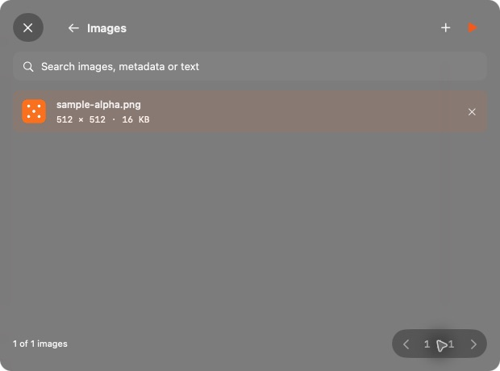

# dice

A small native Mac app for image conversion, compression, resizing and metadata inspection. Built in Swift with SwiftUI, AppKit and ImageIO.

## What Dice does

Convert, resize and compress images in a small native window. Inspect all image metadata, remove personal tags and search a batch by filename, metadata or recognized text. Processing stays on your Mac, and original files stay untouched.




## v0.1.7 preview

- Launch from Applications or right-click an image → Quick Actions → Edit with Dice. The Dock icon appears while the editor is open and disappears when it closes.
- Launch opens the drop surface without an automatic file picker. Drag-over lights the full window edge with a soft aurora glow.
- A compact 620 × 460 native blurred window with shared system-font typography and controls in the top-right corner. A matching top-left close button replaces native traffic lights; minimize and fullscreen are disabled.
- Bottom-right previous/page/next controls work across image, metadata and batch views. Click the page number for a searchable image list; removing an entry preserves its original file. Search matches names, paths, image properties, metadata tags/values and recognized text.
- Batch JPEG, PNG, HEIC and WebP conversion. Native encoders are checked on the current Mac.
- Quality control for lossy output and optional lossless WebP.
- Resize by longest edge, percentage or a bounding box, preserving proportions without upscaling.
- Remove personal metadata by default. Metadata-only mode uses ExifTool without recompressing pixels, retaining colour profiles and orientation.
- Compact summary: dimensions, size, format, camera, capture time and presence of GPS tags.
- Extensive ExifTool tag viewer: search tags/values, filter by group, select a tag to read its full value, copy values or all tags, and export JSON.
- Start applies the current settings to the batch; the down-arrow saves processed copies. Originals are preserved. Metadata replaces the image in the same window; the back arrow returns to it.
- Check for Updates… downloads signed releases from the public binary-only repository. Include Preview Releases toggles the preview channel; checks are manual by default.
- Last-used processing settings persist locally.
- Serial background processing, bounded previews and no idle polling. Stop finishes the current image, then stops the batch.

### Try it

Download the Apple-silicon ZIP from [Dice Releases](https://github.com/lumen-xx/dice-releases/releases) and extract it outside a cloud-synced folder. Move Dice.app into Applications and open it there. Use Open With → Dice, or install the Finder Quick Action from the development checkout. This preview is locally ad-hoc signed, **not Developer ID signed or notarized**; distribution signing remains to be configured. Dice targets macOS 14 or newer, but this preview has been tested only on the development Mac. Intel builds have not been produced.

The app bundles ExifTool and WebP tools. No Homebrew installation is needed to run it. It currently relies on `/usr/bin/perl`, supplied by the supported macOS system; compatibility across clean macOS installations still needs validation. Image processing stays local. Update checks contact GitHub only when requested; no account or GitHub token is required in the app.

### First launch on macOS

Dice is currently a development preview, so macOS may block the first downloaded copy. Download it from [our Releases page](https://github.com/lumen-xx/dice-releases/releases), unzip it and move **Dice.app** to **Applications**.

**Using System Settings**

1. Try opening Dice once.
2. Open **System Settings → Privacy & Security**.
3. Scroll to the security message about Dice and click **Open Anyway**.
4. Confirm **Open** and authenticate if macOS asks.

See [Apple’s opening instructions](https://support.apple.com/en-us/102445) for details.

**Using Terminal**

For the Dice copy you downloaded from our Releases page, paste this into Terminal:

```sh
xattr -dr com.apple.quarantine /Applications/Dice.app
```

Then open Dice from Applications. This removes the download quarantine flag from Dice only; it does not disable Gatekeeper system-wide. If you installed Dice somewhere else, use that app’s path instead.

Once you have an updater-enabled build, use **Dice → Check for Updates…** for later releases.

### Build

Requires Apple Command Line Tools (Swift 5.9+), Python 3, and local Homebrew installations of **ExifTool 13.50** and **WebP 1.6.0**. These are the development-preview pins; the packaging script rejects different versions instead of silently changing the shipped tools. A source-download build for pinned dependencies is future work.

```sh
swift build -c release
python3 scripts/package.py
python3 scripts/install-quick-action.py
```

Enable **Edit with Dice** in System Settings → General → Login Items & Extensions → Finder, if macOS leaves the new Quick Action disabled. It is already installed and enabled on the development Mac. The action is image-only and lives at `~/Library/Services/Edit with Dice.workflow`; removing that workflow uninstalls the action. The installer refuses to overwrite an existing action unless `--update` is supplied for a workflow generated by Dice. It prefers `/Applications/Dice.app`; use `--app` to select another app location.

The ZIP is written to `build/Dice-v0.1.7-apple-silicon.zip`. The signed application is `build/Dice.app` (also recorded in `build/app-path.txt`). Build outside cloud-synced folders, which can attach Finder metadata that breaks signing. The packaging script enforces an installed size below 40,000,000 bytes.

See the [interface style guide](docs/STYLE_GUIDE.md) and [validation details](docs/VALIDATION.md).

### Run processing checks

After packaging:

```sh
DICE_TOOLS="$(cat build/app-path.txt)/Contents/Resources/Tools" swift run -c release DiceChecks
```

The standalone runner needs no XCTest installation. Checks exercise resize validation and aspect ratio, original preservation, real JPEG compression, ExifTool inspection/stripping, pixel equality after metadata-only stripping, EXIF orientation, bundled WebP encoding, metadata preservation, cross-field search and filename collisions. Generated fixtures contain no personal data.

## Current limits

- PNG uses native lossless re-encoding, not a dedicated PNG optimiser; it can become larger.
- Converted files can grow. Dice reports actual input/output sizes and never promises savings.
- Animated and multi-image files are rejected by conversion to prevent silently discarding frames. Metadata-only removal is limited to JPEG, PNG, HEIC and WebP. TIFF metadata-only stripping is rejected because a blanket ExifTool deletion can leave personal TIFF tags; convert TIFF to a supported output instead.
- JPEG transparency is flattened onto white. Converted HDR/gain-map images are not preserved as HDR in this preview.
- RAW development, SVG/PDF rasterisation, AVIF export, target-file-size compression, side-by-side before/after comparison, login-item settings and per-file overrides are not implemented.
- The metadata viewer displays textual ExifTool output. Embedded binary blobs are described rather than decoded or exported. File-system properties are shown for inspection; metadata stripping does not anonymise filenames or file-system attributes.
- No persistent processing history. Session results are removed when the editor closes or on a normal quit. A crash can leave temporary results behind.
- Output files are generated in a temporary session directory; use Save or drag a result out before quitting.

## Resource goals

Current packaged preview: approximately **26.2 MB installed / 7.8 MB zipped**, including bundled metadata and WebP tools. An initial visible-window idle sample was **0.0% CPU and about 119 MiB resident memory** on the development Mac; this is a snapshot, not a benchmark or guarantee. No repeating timers or watchers run at idle. Memory profiling and hidden-window measurements are still needed.

## Dependencies

See [THIRD_PARTY_NOTICES.md](THIRD_PARTY_NOTICES.md) and `vendor/licenses/`. Dice's original source has no open-source license assigned yet. Third-party components retain their respective licenses.

## Publishing updates

See [the update guide](docs/UPDATES.md). `updates/version.json` defines version, increasing build number and stable/preview channel. Sparkle is pinned to 2.10.0 in SwiftPM. Release assets and appcast signatures use the Dice-specific key in the local login Keychain. Private signing keys and GitHub credentials are never embedded in the app.
